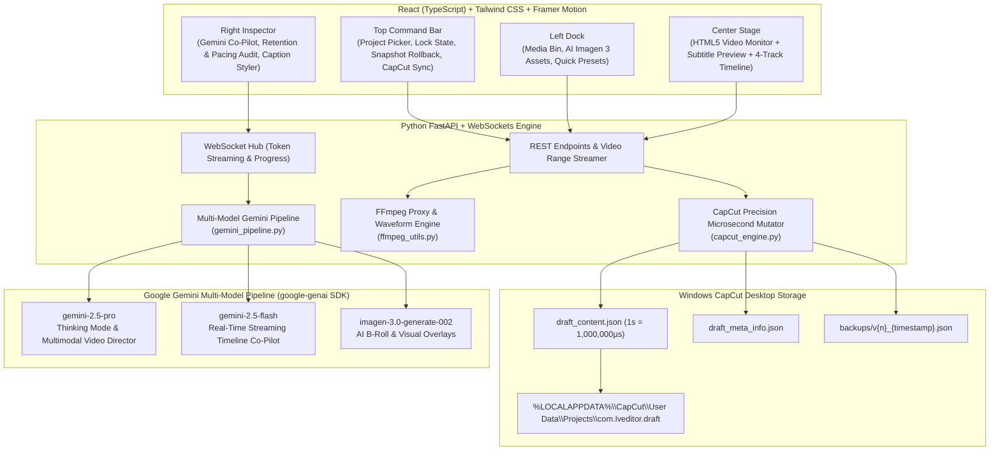

# SRII ARTS — AI-Native Desktop NLE Studio Director

**SRII ARTS** is a professional, studio-grade desktop web application designed to act as an autonomous AI Video Director and timeline co-pilot for **CapCut Desktop (Windows)**. Inspired by the high-density, dark-mode ergonomics of **DaVinci Resolve**, **Premiere Pro**, and **Linear**, SRII ARTS bridges multimodal video reasoning directly with CapCut's microsecond project schemas.

---

## 🏛️ System Architecture



---

## ⚡ Core Capabilities

### 1. Deep Multimodal Video Director (`gemini-2.5-pro`)
- **Thinking Mode Enabled**: Activates deep reasoning via `thinking_budget` in `google-genai` SDK.
- **File API Video Ingestion**: Streams full raw video files (`client.files.upload`), waiting for `ACTIVE` state before running multimodal token analysis.
- **Structured Pydantic Audit (`VideoDirectorAnalysis`)**:
  - **Retention Score (0–100)** with first 3-second brutal hook critique.
  - **Pacing Rhythm Score (0–100)** with beat recommendations.
  - **Frame-Accurate Scene Detection** with categorized energy levels.
  - **Dead-Air / Filler Word Detection** ('um', 'uh', hesitations).
  - **Strategic B-Roll Gap Suggestions** with detailed prompts for Imagen 3.
  - **3 Alternative Viral Hooks** ready for immediate use.

### 2. Real-Time Timeline Co-Pilot (`gemini-2.5-flash`)
- **Live Streaming Responses**: Interactive chat panel with token-by-token streaming via WebSockets.
- **Natural-Language Timeline Mutations**: Translates directives like:
  - *"Tighten the pacing to a 3-second cut rhythm, remove 'ums', and generate dynamic 3-word Hormozi-style captions"*
  into executable structured actions (`RIPPLE_DELETE`, `INJECT_CAPTIONS`, `ADD_B_ROLL`, `APPLY_PRESET`).
- **Interactive Diff Card**: Preview proposed timeline changes before executing them with a single click.

### 3. AI B-Roll & Thumbnail Generator (`imagen-3.0-generate-002`)
- Generates 16:9 or 9:16 visual overlays directly from Gemini's director recommendations into `/generated_assets`.
- One-click insertion onto track **V2** at the current playhead cursor.

### 4. Precision Microsecond CapCut Engine (`capcut_engine.py`)
- **$1\text{s} = 1,000,000\mu\text{s}$ Precision**: Directly mutates `draft_content.json` matching CapCut Desktop schemas.
- **Non-Destructive Ripple Delete**: Slices clips around filler words, recalculates `source_timerange` and `target_timerange`, and shifts subsequent clips left so there are zero black-frame gaps.
- **Dynamic Multi-Layer Caption Injector**: Injects text tracks with customizable font sizes, strokes, and color schemes:
  - **Hormozi Bold**: Uppercase bold text with high-contrast yellow highlights and black outlines.
  - **Cyber Neon**: Neon cyan with magenta accents and glow styling.
  - **Clean Minimal**: Sleek white modern subtitle typography.
- **B-Roll Overlay Track Builder**: Inserts photos or videos onto upper video tracks (`track_index > 0`) at exact timestamps.
- **Auto-Discovery & File Locking**: Automatically discovers drafts at `%LOCALAPPDATA%\CapCut\User Data\Projects\com.lveditor.draft`, checks process locks via `psutil`, and provides versioned snapshot backups (`backups/v{n}_{timestamp}.json`) with one-click instant rollback.

### 5. FFmpeg Proxy & Audio Waveform Engine (`ffmpeg_utils.py`)
- Automatically utilizes bundled `imageio-ffmpeg` binary (no external system installation required).
- Generates lightweight **480p web proxies** for fluid in-browser HTML5 playback.
- Extracts **800-point normalized audio amplitude peak arrays** for interactive timeline canvas scrubbing.
- Detects silence periods via FFmpeg `silencedetect`.

---

## 🌐 Live Production Deployment

- **Vercel Production URL**: [https://srii-arts.vercel.app](https://srii-arts.vercel.app)
- **Deployment Status**: `READY` (Linked to project `srii-arts` under `srikanth-j-s-projects`)
- **Vercel Preview URL**: [https://srii-arts-r5virguvs-srikanth-j-s-projects.vercel.app](https://srii-arts-r5virguvs-srikanth-j-s-projects.vercel.app)

---

## 🚀 Quick Start Guide

### Prerequisites
- **Windows 10 / 11**
- **Python 3.10+**
- **Node.js 18+**
- *(Optional)* CapCut Desktop installed (if not installed, SRII ARTS automatically scaffolds realistic sample projects so you can test all features immediately).

### 1. Installation
Clone the repository and install dependencies:

```bash
# Python Backend Dependencies
cd backend
python -m pip install -r requirements.txt
cd ..

# Frontend React Dependencies
cd frontend
npm install
cd ..
```

### 2. Configure Environment Variables
Copy `.env.example` to `backend/.env` and insert your Gemini API Key:

```env
GEMINI_API_KEY=AIzaSy...your_gemini_api_key_here
CAPCUT_PROJECTS_DIR=
```
*(You can also configure or change the API key directly in the UI via the Settings modal!)*

### 3. Launching the Studio
You can run the one-click launcher:

```bash
# Using batch file:
start_studio.bat

# Or using PowerShell:
.\start_studio.ps1
```

Or start the servers manually in two terminals:

```bash
# Terminal 1: Backend
python -m uvicorn backend.main:app --host 127.0.0.1 --port 8000 --reload

# Terminal 2: Frontend
cd frontend
npm run dev
```

Open your browser at: **`http://localhost:5173`**

---

## ⌨️ NLE Workspace Layout & Controls

| Zone | Component | Purpose |
| :--- | :--- | :--- |
| **Zone 1: Top Bar** | **Command Bar** | Project selector, CapCut lock indicator (`READY`/`LOCKED`), Gemini Model toggle (Pro vs Flash), Snapshot History, Settings, and "Sync & Write to CapCut" CTA button. |
| **Zone 2: Left Dock** | **Media Bin & Assets** | Raw project media clips, 480p proxy generator, AI B-Roll gallery (Imagen 3), and one-click presets ("YouTube Retention Cut", "Reels High-Pacing", "Podcast Clean-Up"). |
| **Zone 3: Center Stage** | **Monitor & Timeline** | Synchronized HTML5 video player with real-time subtitle preview overlay + 4-Track zoomable timeline (V2 B-Roll, V1 Video with Keep/Cut toggle, A1 Waveform, T1 Captions). |
| **Zone 4: Right Dock** | **Inspector** | Streaming AI Co-Pilot chat with quick prompt chips, Gemini 2.5 Pro Retention & Pacing audit with clickable timestamp jump markers, and Caption Styler. |

### Keyboard Shortcuts
- **`Spacebar`**: Play / Pause preview video.
- **`Left Arrow` (`←`)**: Step playhead backward 1 second.
- **`Right Arrow` (`→`)**: Step playhead forward 1 second.
- **`Click on Cut Zone`**: Toggle segment between **`✔ KEEP`** (green) and **`✂ CUT`** (red).

---

## 🔒 CapCut Sync & Safe Rollback

1. **Auto-Lock Detection**: When CapCut Desktop is actively holding open files, SRII ARTS flags the status as `LOCKED` to prevent corrupting active sessions.
2. **Versioned Safety Snapshots**: Before executing any mutation (ripple delete, b-roll insertion, caption sync), SRII ARTS captures a timestamped snapshot in `backups/v{n}_{timestamp}_{label}.json`.
3. **One-Click Rollback**: Open the **Snapshots** modal in the top command bar at any time to inspect past versions and restore previous project states instantly.

---

## 📁 Repository Structure

```text
d:\capcut x gemini\
├── backend/
│   ├── main.py              # FastAPI server, media range streamer, WebSockets
│   ├── capcut_engine.py     # Microsecond JSON mutator & draft parser
│   ├── gemini_pipeline.py   # Multi-model Gemini & Imagen pipeline (google-genai)
│   ├── ffmpeg_utils.py      # 480p proxy & audio waveform peak generator
│   ├── schemas.py           # Pydantic models for structured outputs & mutations
│   ├── sample_drafts/       # Scaffolds realistic CapCut projects for offline testing
│   ├── generated_assets/    # Saved AI B-roll images from Imagen 3
│   ├── proxies/             # Cached 480p proxy videos & waveform peaks JSON
│   ├── requirements.txt     # Python backend dependencies
│   └── .env.example         # Environment template
│
├── frontend/
│   ├── src/
│   │   ├── components/      # CommandBar, LeftDock, VideoMonitor, Timeline, RightInspector, Modals
│   │   ├── utils/           # Timecode and microsecond formatters
│   │   ├── api.ts           # Typed API client
│   │   ├── types.ts         # TypeScript interfaces
│   │   ├── App.tsx          # Master 4-Zone NLE Layout coordinator
│   │   ├── index.css        # Tailwind & dark theme styling
│   │   └── main.tsx         # React root
│   ├── package.json         # React + Vite dependencies
│   ├── tailwind.config.js   # NLE palette (DaVinci/Premiere/Linear theme)
│   └── vite.config.ts       # Reverse proxy routes for /api, /ws, /media
│
├── start_studio.bat         # One-click Windows launch script
├── start_studio.ps1         # One-click PowerShell launch script
├── package.json             # Root monorepo scripts
└── README.md                # Documentation & architecture guide
```

---

*Built with precision for creators and editors.*
